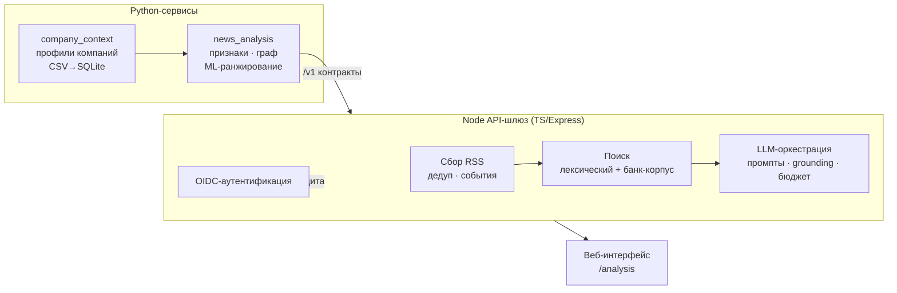

# 📊 Alfa News Agent

**Персональная новостная аналитика для бизнеса: профиль компании → релевантные новости → обоснованный (grounded) LLM-анализ с источниками → уточняющие вопросы.**

Командный хакатон-проект для **Альфа-Банка**. Гибридная система на **Python + Node.js** с общими `/v1`-контрактами, обучаемым ранжированием новостей и LLM-анализом, где каждый вывод подкреплён цитатой из источника.

<p>
  
  
  
  
  
</p>

> 👤 **Моя роль в команде — бекенд:** Node API-шлюз (TypeScript/Express), Python-сервисы аналитики и инфраструктура/деплой. Подробнее — в разделе [«Мой вклад»](#-мой-вклад-backend).

---

## 💡 Задача и решение

Бизнесу важно вовремя замечать новости, которые реально на него влияют, — но в потоке их легко пропустить, а «аналитика» часто оказывается пересказом без фактов.

**Alfa News Agent** строит это как конвейер:

1. **Профиль компании** — из банковских данных (CSV → SQLite): сфера, платёжные связи, контрагенты, provenance каждого значения.
2. **Сбор и очистка новостей** — RSS, извлечение дат и версий текста, дедупликация перепечаток, извлечение событий с указанием источника.
3. **Ранжирование релевантности** — признаки + граф косвенных связей + обучаемый ranker (baseline/ML) с дообучением по обратной связи.
4. **LLM-анализ** — модель получает профиль, новость, ML-оценку и банковские фрагменты (RAG); ответ структурирован, **каждое утверждение проверяется на наличие цитаты** (grounding), указаны условия, ограничения и недостающие данные.
5. **Уточняющие вопросы** — диалог поверх сохранённого контекста анализа.

---

## 🏗️ Архитектура



Python и Node общаются по единым **`/v1`-контрактам** (JSON Schema 2020-12 + OpenAPI 3.1) — с адаптерами, моками и общим запуском, что позволяло вести разработку параллельно пятью ролями.

---

## ✨ Ключевые возможности

- 🎯 **Персонализация** — профиль компании строится из реальных банковских данных, релевантность считается под конкретный бизнес.
- 🧠 **Обучаемое ранжирование** — ML-ranker с дообучением по человеческой обратной связи; новая версия весов включается только после проверки на отложенных данных (есть история и откат).
- 🔎 **RAG + grounding** — LLM-ответ привязан к источникам: проверка цитат и оснований, явные условия рекомендаций и пометки о недостающих данных (никаких «галлюцинаций» без ссылки).
- 💸 **Контроль стоимости** — учёт бюджета LLM-вызовов в рублях.
- 🔐 **Безопасность** — аутентификация через OIDC (jose / openid-client), production-контур с TLS.
- 🧪 **Оценка качества** — харнессы `llm:evaluate`, `rag:evaluate`, сценарии оценки, контрактные и интеграционные тесты, CI.

---

## 🛠️ Технологии

| Слой | Стек |
|---|---|
| **API-шлюз** | Node.js 24 · TypeScript · Express · ajv (валидация схем) · fast-xml-parser (RSS) · parse5 |
| **Аутентификация** | OIDC — `jose`, `openid-client` |
| **Аналитика** | Python 3.12 · обучаемое ранжирование · граф релевантности · SQLite |
| **Контракты** | JSON Schema 2020-12 · OpenAPI 3.1 |
| **Инфраструктура** | Docker · Docker Compose (dev/live/news/production) · GitHub Actions CI · Render |
| **Тесты** | pytest · node:test · Playwright (e2e) |

---

## 👤 Мой вклад (backend)

В команде я отвечал за серверную часть и инфраструктуру:

**🔹 Node API-шлюз** (`server/`, TypeScript/Express)
- Сбор и нормализация новостей из RSS: извлечение дат публикации и версий текста, дедупликация перепечаток, извлечение событий с привязкой к источнику.
- Поиск: лексический поиск по новостям и по банковскому корпусу (RAG-ретрив).
- Оркестрация LLM: промпты, проверка цитат и оснований (grounding), контроль бюджета вызовов, структурированный ответ по схеме.
- Аутентификация через OIDC и защищённый production-контур.
- Единые `/v1`-эндпоинты и валидация запросов/ответов по JSON Schema.

**🔹 Python-аналитика** (`news_analysis/`, `company_context/`)
- Построение профиля компании из CSV в SQLite с provenance и обработкой неизвестных значений.
- Признаки новостей, граф косвенной релевантности, baseline/ML-ранжирование и условная оптимизация действий.
- Подготовка датасетов и сборщик для офлайн-оценки.

**🔹 Инфраструктура и деплой**
- Docker-образы для Node и Python, Docker Compose под разные контуры (demo/live/news/production).
- CI на GitHub Actions (типчек, тесты, сборка, проверка контрактов), конфиг деплоя (Render).

---

## 🚀 Запуск (локально, без Docker)

Нужны **Python 3.12** и **Node.js 24.13+**. Из корня проекта:

```bash
python -m venv .venv && source .venv/bin/activate
python -m pip install -r requirements-dev.txt -c requirements.lock
npm ci
npm run integration:dev
```

Открыть **<http://localhost:8000/analysis/>** → выбрать компанию и новость → посмотреть контекст → получить ответ с источниками → задать уточнения.
Одна команда поднимает Python API, Node-шлюз и моки. Стенд использует небольшие синтетические данные и локальные базы — без внешних LLM.

Проверки:
```bash
python scripts/build_contracts.py --check   # контракты
npm run typecheck && npm test && npm run build
```

> Полная документация команды, карта проекта и инструкции по подключению реального LLM/ML — в [`docs/INDEX.md`](docs/INDEX.md) и исходном [`README.project.md`](README.project.md).

---

<sub>Командный проект на хакатоне Альфа-Банка (5 ролей). Исходный репозиторий: <a href="https://github.com/AzatBadretdinov/alfa-news-agent">AzatBadretdinov/alfa-news-agent</a>. Этот репозиторий оформлен как портфолио с акцентом на мой бекенд-вклад.</sub>
