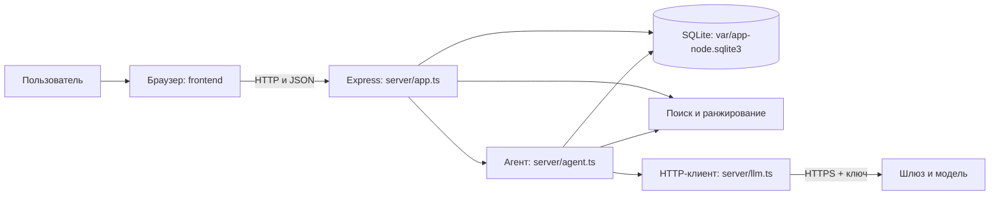
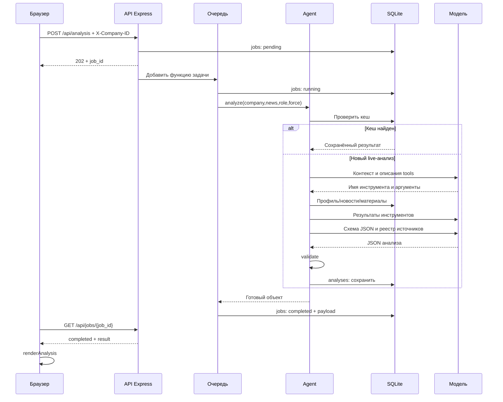

# Alfa Insight: полный разбор проекта

Этот материал объясняет текущую локальную версию в `D:\Develop\study\hackathon\alfa-insight-v1` на 23 октября 2026. Начни с разделов 1–6, потом переходи к каждому исходнику. Построчный справочник находится в [LINE_BY_LINE.md](LINE_BY_LINE.md), а интерактивный выбор файла/строки — в [CODE_TOUR.html](CODE_TOUR.html).

Построчный снимок содержит **24 файлов и 2786 физических строк**: собственные исходники, тесты, настройки и npm lockfile. У каждой строки есть пояснение. Длинные CSS-строки дополнительно разобраны по селекторам и свойствам. Настоящий `.env` с ключом в материалы не включён; все его поддерживаемые настройки объясняются через `.env.example`.

Командное распределение и текущий план: [TEAM_GUIDE.md](../process/TEAM_GUIDE.md), [TASKS.md](../process/TASKS.md), [роль 3 Backend/RAG](../process/ROLE_3_BACKEND_RAG.md). Построчные материалы ниже относятся к учебному снимку; при изменении исходников сверять его с кодом.

## 1. Какую задачу решает продукт

Обычная лента показывает одну и ту же новость разным компаниям. Наш прототип должен ответить на другой вопрос: «Что это событие может значить именно для этой компании и что стоит проверить?»

Для этого ему нужны четыре вида информации:

1. **Компания:** отрасль, регион, продукты банка, признаки внешней торговли, наблюдаемые платёжные связи.
2. **Новость:** заголовок, текст, дата, ссылка, тематические признаки.
3. **Материалы банка:** текст распознанных страниц, ссылка на оригинал и номер страницы.
4. **Роль пользователя:** финансовому директору, генеральному директору и казначею могут быть полезны разные акценты.

Результат — краткое содержание, объяснение связи с компанией, факты новости, цитаты банка, выводы AI, риски, возможности, действия, ограничения и источники.

Это локальный прототип. Экран похож на оболочку «Альфа-Бизнеса», но настоящего подключения к интернет-банку, банковскому аккаунту или платёжным операциям нет.

## 2. Пять частей системы



**Браузер** рисует интерфейс и отправляет запросы. Он не имеет доступа к SQLite, исходным CSV или API-ключу модели.

**Node.js** выполняет серверный JavaScript на компьютере. **Express** помогает ему принять HTTP-запрос, разобрать JSON, выбрать обработчик и вернуть ответ.

**SQLite** — библиотека и файл базы, а не отдельный запущенный сервер PostgreSQL. Наш Node-процесс открывает этот файл напрямую. Данные остаются после закрытия окна браузера.

**Retrieval** выполняет обычный поиск и правила ранжирования. Обновление ленты, профиль компании и поиск банковских материалов не требуют вызова модели.

**Agent** управляет общением с моделью и инструментами. Модель предлагает имя инструмента и аргументы; наш код решает, что разрешено, и сам выполняет соответствующую функцию.

TypeScript добавляет описания типов к JavaScript. При сборке они исчезают. Поэтому `interface Company` помогает при разработке, но сам по себе не проверит JSON, полученный из сети; для этого нужны обычные проверки вроде `Array.isArray` и `validate`.

## 3. Что лежит в каждой папке

| Путь | Что это и когда читается |
|---|---|
| `server/index.ts` | Точка входа: настройки → приложение → порт → остановка. |
| `server/config.ts` | Корень проекта, окружение, список моделей/ролей, лимиты. |
| `server/types.ts` | Описания объектов и классы безопасных ошибок. |
| `server/app.ts` | Маршруты API, middleware, очередь, раздача `frontend/`. |
| `server/db.ts` | Таблицы, импорт CSV и сбор профиля из SQL. |
| `server/retrieval.ts` | Темы, банковский поиск и персональный балл новости. |
| `server/news.ts` | Ручная новость, SHA-256-дедупликация, RSS/Atom. |
| `server/llm.ts` | Реальный HTTPS-запрос к шлюзу, ключ, usage и ошибки. |
| `server/prompts.ts` | Две текстовые инструкции модели: SYSTEM и SCHEMA. |
| `server/agent.ts` | Кеш, инструменты, цикл модели, проверка, история вопросов. |
| `server/tests/app.test.ts` | 18 сценариев с временными данными и подставной моделью. |
| `frontend/index.html` | Каркас страницы, формы и DOM-элементы с ID. |
| `frontend/styles.css` | Внешний вид и правила для разных ширин экрана. |
| `frontend/app.js` | Состояние браузера, HTTP-вызовы, рендер и обработчики. |
| `data/df_Uid_data_hack.csv.gz` | Сжатые карточки компаний. |
| `data/df_Uid_payment_hack.csv.gz` | Сжатые наблюдаемые платежи. |
| `data/df_Fid_Uid_link_hack.csv.gz` | Сжатые пары физлицо—компания. |
| `data/research.json` | Подготовленный OCR-текст 64 страниц девяти документов банка. |
| `data/demo_news.json` | Шесть явно синтетических стартовых новостей. |
| `data/manifest.json` | Имена, размеры и SHA-256 файлов данных: это описание происхождения, а не код загрузки. Сервер сейчас не сверяет эти хеши автоматически. |
| `var/app-node.sqlite3` | Рабочая база со всеми импортами, новостями, анализами, вопросами и счётчиком. |
| `var/*-wal` | Журнал SQLite в режиме WAL, если он существует. Часть актуальных изменений может быть здесь, а не в основном файле. |
| `var/*-shm` | Служебная общая память/индекс WAL. Это не отдельный набор новостей. |
| `dist/` | Автоматический JavaScript после `npm run build`; `.js.map` связывает его со строками TS. В сборку входят и тесты, потому что include охватывает `server/**/*.ts`. |
| `node_modules/` | Внешние npm-пакеты и их зависимости. Их код установлен извне, версии зафиксированы в lockfile. |
| `.env` | Локальные реальные настройки с ключом. При запуске читает только сервер. |
| `.env.example` | Образец настроек без ключа. |
| `.nvmrc` | Подсказка версии Node менеджеру версий. |
| `package.json` | Команды npm, версия Node и прямые зависимости. |
| `package-lock.json` | Точное дерево пакетов и их контрольные суммы. |
| `tsconfig.json` | Что и как проверяет/собирает TypeScript. |
| `.gitignore` | Что не добавлять в будущие Git-коммиты. |
| `.dockerignore` | Что не отправлять в контекст сборки контейнера. |
| `Dockerfile` | Как собрать и запустить готовый Node-образ. |
| `compose.yaml` | Локальный порт, `.env` и постоянный том базы контейнера. |
| `start_windows.bat` | Удобный запуск через cmd.exe двойным щелчком. |
| `README.md` | Быстрый запуск, команды и границы версии. |
| `TASKS.md` | Список доработок без назначения участников. |
| `HANDOFF.md` | Короткое текущее состояние для продолжения работы с ассистентом. |
| `THIRD_PARTY_NOTICES` | Внешние компоненты, лицензии, данные и имитации интеграций. |
| `docs/ARCHITECTURE.md` | Архитектура и API. |
| `docs/NODE_MIGRATION.md` | История переноса и фактических проверок, включая неудачные live-запуски. Старые записи описывают состояние на момент соответствующей проверки. |
| `docs/CODE_GUIDE.md` | Этот учебный маршрут. |
| `docs/LINE_BY_LINE.md` | Код и объяснение каждой строки выбранного снимка. |
| `docs/CODE_TOUR.html` | Тот же снимок с выбором файла, строки и локальным поиском; открывается как самостоятельный документ. |
| `docs/CODE_TOUR_MANIFEST.json` | Список разобранных файлов, числа строк и SHA-256; позволяет проверить соответствие учебного снимка исходникам. |

Старые Python-файлы находятся в отдельном резервном ZIP рядом с папкой проекта и больше не участвуют в запуске. Рабочая папка пока не является клоном командного GitHub: изменения локальных файлов не появляются на GitHub сами.

## 4. Как сервер запускается

1. `npm start` читает `scripts.start` и запускает `tsx server/index.ts`.
2. `loadSettings()` копирует `process.env` и дополняет его из `.env`. Переменная настоящего окружения имеет приоритет над `.env`.
3. `createApplication(settings)` открывает SQLite через `new Store(settings)`.
4. `initialize()` создаёт отсутствующие таблицы. Если нет `import_complete`, читает три gzip CSV потоками и вставляет записи в одной транзакции.
5. Создаются индексы, загружается `research.json`; при пустой `news` добавляются demo-новости.
6. Прерванные задачи прошлого процесса помечаются `failed`.
7. Собираются `Retrieval`, `Agent`, `AnalysisQueue` и Express-маршруты.
8. `app.listen` начинает принимать HTTP-запросы на `127.0.0.1:8000`.

`npm run build` выполняет другой путь: `tsc` создаёт `dist/`, после чего можно запустить `node dist/index.js`. Это одна реализация, а не второй бэкенд. Изменение `.ts` не обновит уже запущенный `dist/index.js` без новой сборки и перезапуска. `npm run dev` вместо этого использует `tsx watch`.

Синхронные SQLite-операции и расчёты выполняются в основном потоке Node. Асинхронное ожидание сети позволяет нескольким анализам ждать модель одновременно, но не превращает SQL в отдельный параллельный worker.

## 5. Что происходит при открытии страницы

Браузер получает `index.html`. Он подключает CSS и JS; `defer` гарантирует, что JS увидит уже разобранные элементы страницы.

Последняя строка `frontend/app.js` вызывает `bootstrap()`:

```text
bootstrap
  → GET /api/bootstrap
  → режим, статистика, предложения компаний, роли, таймаут
  → selectCompany
  → GET /api/companies/{id}
  → renderProfile + loadFeed
  → GET /api/feed с X-Company-ID
  → renderFeed
```

`state` хранится в памяти страницы. `localStorage` запоминает только выбранный ID компании. `generation` — счётчик актуальности: если пользователь переключился на другую компанию, поздний ответ старого запроса не должен перерисовать новую страницу.

Во фронтенде нет React, JSX, сборщика или клиентского роутера. Три экрана — это секции HTML с переключением `hidden`. Динамические области собираются строками HTML; поэтому `esc()` и безопасная проверка URL обязательны.

`render...` означает «отрисовать уже имеющиеся данные». `load...`, `search...`, `api` и `openNews` могут обращаться к серверу. Это полезное разделение при чтении файла.

## 6. Полный путь одной новости

Пусть выбрана `U_57706`, новость `demo-rate`, роль «Финансовый директор».



**Job ID и analysis ID — разные вещи.** У каждого открытия может быть новая задача; одинаковый кешируемый анализ при этом имеет тот же analysis ID. Поэтому наличие новой job не означает новый платный запрос.

Обычное открытие использует `force=false` и пробует кеш. Кнопка «Пересчитать» использует `force=true` и обходит кеш. Смена роли тоже меняет ключ; новый анализ может расходовать API.

В очереди максимум 10 незавершённых задач, одновременно запускаются две. Это общая ёмкость, а не 10 ожидающих плюс две активные. Задачи хранятся в памяти процесса; SQLite хранит их состояние, но не умеет автоматически продолжить код задачи после рестарта.

## 7. База: что означает каждая таблица

| Таблица | Что хранит | Основные связи |
|---|---|---|
| `companies` | Исходную карточку и отдельные поля поиска | `id` компании |
| `payments` | Наблюдаемые платёжные строки | `payer`, `beneficiary` — ID участников |
| `links` | Пары физлицо—компания | `person`, `company` |
| `research` | OCR-страницы банка | `id`, остальное в JSON |
| `news` | Новости и темы | `id` новости |
| `analyses` | Готовый анализ | `company_id`, `news_id`, `cache_key` |
| `jobs` | Состояние выполнения | `id` задачи, `company_id` |
| `chats` | Историю вопросов и текстов ответов | `company_id`, `analysis_id` |
| `llm_calls` | Попытки вызова и usage | `day`, `model`, ID попытки |
| `metadata` | Служебные признаки импорта | `key`, `value` |

Многие поля `payload` — текст JSON. SQLite не хранит внутри них живой JavaScript-объект: `JSON.stringify` превращает объект в строку, `JSON.parse` восстанавливает его после чтения.

Внешние ключи на уровне SQLite в этой схеме не объявлены. Соответствие компаний, новостей и анализов в основном проверяется кодом. Участник платежа может отсутствовать в таблице компаний: это ограничение покрытия исходной выборки.

Профиль `db.company(id)` собирается несколькими запросами:

1. Карточка компании и её raw JSON.
2. Число строк/сумма исходящих и входящих платежей.
3. Пять получателей наибольших исходящих сумм, с отраслью через `LEFT JOIN`.
4. Другие компании, связанные с теми же физлицами, через соединение `links` с самой собой.
5. Продукты и ФТС из признаков исходной карточки.

Важно: `outgoing.n` — число строк, а не сумма `PAY_CNT`. Самоплатежи пока учитываются. Дубликаты компаний обрабатываются последней строкой, а пропавшее/нечисловое значение часто превращается в 0. Это реальные ограничения местной реализации.

## 8. Что делает поиск и почему новости меняют порядок

`tags(text)` ищет короткие фрагменты слов из словаря THEMES. Например, «кредит» и «ставка» добавляют `rates`, «импорт» — `trade`. Это простые правила.

Интересы компании собираются из отрасли, продуктов, внешнеторгового признака и отраслей крупнейших контрагентов. Затем они пересекаются с темами новости.

```text
score = min(95,
  20
  + 18 × число общих тем
  + 8, если общая тема rates
  + 12, если общая тема trade и у компании есть ФТС
)
```

При двух общих темах, среди которых rates, без внешнеторговой надбавки получаем `20 + 2×18 + 8 = 64`, то есть высокий приоритет. Это не вероятность ущерба 64% и не оценённый денежный эффект.

Поиск банка устроен отдельно: разбивает OCR-страницы на перекрывающиеся отрывки, сравнивает усечённые слова и темы запроса с отрывками, сортирует по баллам и ограничивает число фрагментов одной страницы. Эмбеддингов, vector DB и поиска в интернете здесь нет.

`tokens()` этого поиска — обрезанные слова. Они не совпадают с токенами, за которые считает оплату модель. Их одинаковое название не означает одинаковую единицу измерения.

## 9. Агент и три инструмента

В TOOLS описываются три разрешённых функции. У каждого описания есть имя, назначение и параметры. Модель не вызывает JavaScript напрямую: она возвращает JSON примерно такого вида:

```json
{"id":"call_1","type":"function","function":{"name":"search_research","arguments":"{\"query\":\"ставка лизинг\"}"}}
```

`arguments` — строка с вложенным JSON. Поэтому сервер сначала делает `JSON.parse(call.function.arguments)`, затем выбирает ветку `execute`.

| Инструмент | Где работает | Что возвращает |
|---|---|---|
| `get_company_profile` | Уже собранный профиль выбранной компании | Объект компании |
| `search_research` | Локальная таблица OCR банка | До пяти фрагментов с ID/текстом/страницей/ссылкой |
| `find_related_news` | До 100 других сохранённых новостей | Три наиболее похожих по словам события |

После выполнения инструментов Agent добавляет `role: tool` с `tool_call_id`, чтобы модель связала ответ с собственным запросом. В следующем раунде она уже видит найденные данные.

До четырёх раундов планирования и до двух финальных JSON-запросов дают максимум шесть LLM-вызовов на новый анализ. В каждом раунде может быть до шести локальных инструментов; каждый инструмент не равен отдельному платному запросу модели.

Если модель закончила планирование раньше, запросов меньше. Успешный проверенный пример использовал три: выбор инструментов → завершение поиска → итоговый JSON.

## 10. Что именно проверяется в ответе

```json
{
  "summary": "Что произошло",
  "why_relevant": "Почему это может касаться выбранной компании",
  "claims": [
    {"kind":"fact","text":"Факт из текста новости","source_ids":["news:demo-rate"],"quote":""},
    {"kind":"ai","text":"Условный вывод","source_ids":["company","news:demo-rate"],"quote":""}
  ],
  "risks": [], "opportunities": [], "actions": [], "limitations": []
}
```

Это учебная форма объекта, не реальная новая новость. `validate` требует:

- непустые summary/why_relevant;
- массивы строк для четырёх списков;
- минимум один fact и один ai;
- только известные source_ids;
- у fact хотя бы одну news-ссылку;
- у ai и company, и news;
- у bank точную цитату длиной от 15 символов, совпадающую с text и присутствующую в research-фрагменте после нормализации регистра/пробелов.

**Проверка формальная.** Если модель приклеила существующие ID к неверному смысловому выводу, этот код не обязан заметить проблему. Поля summary/why_relevant и списки рисков/действий не имеют отдельной семантической проверки. OCR-ошибка в источнике тоже может пройти как точная цитата.

Один раз модель может получить замечания и исправить ответ. Если не получилось — результат не сохраняется. Если шлюз сообщил обрезание по лимиту, повтор такого же repair не запускается: сервер возвращает отдельную понятную ошибку.

## 11. Как работает уточняющий вопрос

Браузер отправляет `POST /api/analyses/{id}/questions` с `{question}` и заголовком компании. Сервер:

1. Проверяет существование анализа именно для этой компании.
2. Проверяет, что режим/модель не изменились.
3. Берёт последние пять пар вопрос—ответ из SQLite.
4. Отправляет модели анализ, его sources, историю и новый вопрос.
5. Требует непустой answer и непустой список только известных ID.
6. Записывает вопрос и текст ответа в chats и возвращает результат.

Новый поиск при этом не производится. Вопрос не переписывает исходный анализ. Браузер хранит видимый разговор отдельно в `state.conversations`; после перезагрузки прошлые пары пока не отображаются автоматически, хотя сервер продолжает использовать сохранённую историю.

Запрос вопроса не стоит в очереди анализов и не кешируется. При двойной ручной отправке можно получить два платных вызова; кнопка в интерфейсе блокируется на время ожидания, но это не серверный глобальный rate limit.

## 12. API на практике

**HTTP** — протокол обращения браузера к серверу. **Endpoint** — конкретный путь и метод. **JSON** — формат данных в тексте запроса/ответа. **Header** — отдельная метаинформация, например выбранная компания.

```text
GET  /api/companies?q=Москва&offset=0   поиск списка
GET  /api/companies/U_57706            профиль
GET  /api/feed?demo=1                  лента с тестовыми новостями
POST /api/analysis                    создать задачу
GET  /api/jobs/ID                      статус/результат
GET  /api/analyses/ID                  сохранённый анализ
POST /api/analyses/ID/questions        задать вопрос
POST /api/news                        сохранить новость
POST /api/feeds/refresh                прочитать настроенные RSS
GET  /api/research?q=ставка            поиск материалов банка
GET  /api/bootstrap                   стартовые сведения
GET  /api/health                      здоровье процесса
```

Статусы: 200 — успешное чтение/ответ, 201 — запись создана, 202 — задача принята, 400 — неверный вход, 403 — отклонён Origin, 404 — запись/путь не найдены, 409 — конфликт режима старого анализа, 413 — слишком большое тело, 429 — очередь/локальный лимит HTTP-слоя, 502 — ошибка модели, 500 — неожиданная внутренняя ошибка. Внешний 429 шлюза внутри ModelError клиент получает как 502 с понятным текстом.

`X-Company-ID` — контекст, а не пароль. Пользователь может сам сменить заголовок. Проверка `company_id` предотвращает случайное смешивание данных в выбранном контексте; настоящих прав доступа в прототипе пока нет.

## 13. Деньги, кеш и таймауты

Ключ попадает только в серверный `Authorization: Bearer ...`. Браузер получает `key_configured: true/false`, но не значение ключа.

Перед каждой попыткой вызова клиент делает транзакцию: считает сегодняшние попытки → проверяет лимит → вставляет новую строку → фиксирует. Между проверкой и вставкой нет await, что защищает последнюю доступную попытку от двух конкурентных анализов этого процесса.

`MAX_DAILY_LLM_CALLS=100` — предел попыток, а не 100 анализов и не 100 рублей. Он использует дату МСК, сбрасывается в 00:00 МСК и не видит другие ПК. Указанный организаторами общий бюджет 500 рублей сбрасывается в 03:00 МСК; локальный код баланс шлюза не получает.

Успешный ответ API может дать `usage.prompt_tokens` и `usage.completion_tokens`. Если запрос оборвался до получения usage, запись останется с нулями; это не доказывает, что провайдер ничего не списал. Точный расход в рублях требует тарифа/биллинга именно шлюза.

`LLM_MAX_PLANNING_TOKENS` и `LLM_MAX_OUTPUT_TOKENS` — отдельные потолки выхода, по умолчанию 6000. `LLM_TIMEOUT_SECONDS=120` — ожидание одного API-вызова. Браузер получает ещё 10 секунд запаса. Многошаговый анализ дольше одного вызова, поэтому запускается фоновой задачей и опрашивается отдельно.

Ключ кеша включает компанию, новость и её текст, роль, режим, модель и VERSION. Он не включает автоматически весь профиль и банковский корпус. Поэтому при изменении правил/источников нужно осознанно изменить VERSION или удалить нужные сохранённые результаты. Обычное повторное открытие готового анализа не тратит модельные токены.

## 14. Как читать встречающийся синтаксис

| Запись | Значение в нашем коде |
|---|---|
| `import/export` | Подключить/предоставить значение другому модулю. |
| `import type` | Импортировать только тип; runtime-импорт не нужен. |
| `interface`, `type` | Описать форму значения для TypeScript, без проверки JSON во время работы. |
| `Record<string, any>` | Словарь со строковыми ключами и слабо проверяемыми значениями. |
| `Promise<T>` | Значение типа T, которое появится после асинхронной операции, либо ошибка. |
| `async/await` | Функция возвращает Promise; await ждёт его, отдавая event loop время на другие дела. |
| `const/let` | Нельзя/можно переприсвоить переменную; const не делает вложенный объект неизменяемым. |
| `() => ...` | Функция-значение, часто callback. |
| `...obj`, `...array` | Копирование свойств/элементов или разворачивание массива в аргументы. |
| `{id, text}` | Сокращённая запись `{id: id, text: text}`. |
| `const {body} = result` | Деструктуризация: достать поле body. |
| `x?.field` | Прочитать поле, если x не null/undefined. |
| `x ?? fallback` | Запасное значение только для null/undefined. |
| `x || fallback` | Запасное значение для любого falsy, включая 0 и пустую строку. |
| `x!` в TS | Сказать компилятору «не null/undefined»; runtime-проверки не добавляет. |
| `!x` | Обычное логическое отрицание; это другая операция. |
| `as News` | Утверждение типа для компилятора; не преобразует объект и не проверяет поля. |
| `as const` | Сохранить точные литеральные типы вместо общего string. |
| `private/public/readonly` | Ограничения доступа/переприсваивания в TypeScript; public параметр конструктора становится полем. |
| `map/filter/some/every` | Преобразовать массив / отобрать / есть хотя бы один / все подходят. |
| `Set` | Коллекция уникальных значений. |
| `Map` | Словарь с методами get/set, в поиске считает результаты на страницу. |
| `JSON.stringify/parse` | Объект → JSON-строка / JSON-строка → значение. |
| `try/catch/finally` | Выполнить / обработать исключение / обязательно освободить ресурс. |
| `void promise` | Намеренно не возвращать Promise из callback; сама работа продолжается. |
| `.then/.catch/.finally` | Обработка успеха/ошибки/любого завершения Promise. |
| `Array.isArray` | Настоящая runtime-проверка массива, в отличие от TypeScript-аннотации. |
| `Object.hasOwn` | Проверка собственного ключа объекта, без свойств прототипа. |
| `?` в SQL | Место для параметра, не строковая склейка пользовательского ввода. |
| `LIKE '%text%'` | Поиск подстроки с SQL-масками. |
| `LEFT JOIN` | Сохранить левую строку, даже если связанная карточка отсутствует. |
| `GROUP BY + SUM` | Объединить строки по ключу и посчитать сумму группы. |
| `COALESCE(x,0)` | Подставить 0 вместо SQL NULL. |
| `BEGIN/COMMIT/ROLLBACK` | Начать транзакцию / зафиксировать / отменить незавершённые изменения. |
| `data-nid`, `data-tab` | HTML-атрибуты, доступные в JS как element.dataset.nid/tab. |
| `innerHTML/textContent` | Разобрать строку как HTML / вставить как обычный текст. |

## 15. Что доказывают тесты

Каждый тест создаёт новые два профиля, одну платёжную строку, связи, OCR и две новости в временной папке. Слушает свободный локальный порт, а после закрывает соединения/базу и удаляет свои данные. Наш рабочий `.env` не используется для настройки этих приложений.

18 сценариев покрывают: импорт; персонализацию; добавление/дедупликацию; полный demo и кеш; ложные источники; fake live с tool calls и repair; отказ без ключа/невалидный результат; HTTP-контракт и usage; конкурентный лимит; безопасные ошибки провайдера; статику/Origin/JSON/размер; RSS/Atom; рестарт/историю; откат импорта; ограничения очереди; обрезание ответа; конкретный номер неверного fact; различение таймаута/сети/JSON.

`assert.equal` проверяет равенство, `assert.deepEqual` — структуру, `assert.rejects` — ожидаемый отказ асинхронной операции. Fake fetch/complete возвращают заготовленные значения: такие проверки полезны для протокола и обработки ошибок, но не оценивают интеллект настоящей модели.

Дополнительно настоящий live-анализ и один вопрос прошли в браузере на синтетическом событии. Это показывает работоспособность цепочки. Новая реальная новость, разные отрасли, мобильный интерфейс и Docker требуют отдельных проверок.

## 16. Что находится в командном GitHub

В последний прочитанный снимок `AzatBadretdinov/alfa-news-agent`, ветка master, commit `c174149ba152ff947f4efdee2c182dd6038b514a`, входят исходные CSV/PDF и отдельный Python-модуль `company_context`.

Он подробнее строит профиль компании: сохраняет варианты конфликтующих карточек, обозначает неизвестные значения, исключает самоплатежи, считает направления/концентрацию платежей и сохраняет происхождение признаков. Есть JSON Schema профиля и 19 тестовых сценариев. Его тесты нами здесь не запускались.

В локальном приложении профиль уже есть, но проще. Пока нет вызова `company_context`, адаптера его JSON и совместимости его SQLite-схемы с нашей. Эта работа полезна для следующего улучшения данных, однако Python-модуль нельзя просто импортировать в Node без отдельного способа обмена. GitHub используется только для чтения; коммиты и push делает пользователь.

## 17. Пределы, которые важно уметь объяснить

1. Наличие кредита/лизинга/депозита не раскрывает сумму, ставку или тип договора. Сохранение ключевой ставки само по себе не доказывает рост расходов.
2. ФТС и страны не доказывают валюту контрактов или направление торговли.
3. Получатель денег не обязательно поставщик; общий человек не доказывает владение.
4. Синтетическая новость может анализироваться настоящей моделью: `is_demo_news` и `mode` — разные флаги.
5. OCR может ошибиться в цифрах. Точное совпадение с ошибкой OCR всё ещё пройдёт формальный validator.
6. Историческая банковская цитата не обязана отражать текущую позицию банка. Автоматической содержательной проверки дат пока нет.
7. База и кеш переживают рестарт, сама функция незавершённой задачи — нет.
8. Смена компании в браузере скрывает старое ожидание, но не отменяет уже запущенную сервером платную работу.
9. Same-origin/CSP/SQL-параметры не заменяют аутентификацию и права доступа к компаниям.
10. Просмотр всех sources — реестр контекста. Источник мог быть найден, но не использован в конкретном claim.

## 18. В каком порядке читать сам код

1. `package.json` → `server/index.ts`: понять команды и точку входа.
2. `server/types.ts` → `server/config.ts`: познакомиться с объектами и настройками.
3. `server/db.ts`: проследить появление данных и сбор профиля.
4. `server/retrieval.ts` → `server/news.ts`: понять обычную логику без модели.
5. `server/app.ts`: связать HTTP-пути с функциями.
6. `server/llm.ts`: понять место настоящего API-запроса, лимиты и ошибки.
7. `server/prompts.ts` → `server/agent.ts`: проследить AI-цикл и валидацию.
8. `frontend/index.html` → `frontend/app.js` → `frontend/styles.css`: сопоставить ID, события, запросы и внешний вид.
9. `server/tests/app.test.ts`: увидеть, как каждое поведение проверяется изолированно.
10. Docker/Compose/батник/ignore/lockfile: разобраться в запуске и воспроизводимости.

Проверка понимания: сумей без подсказки пройти путь от кнопки новости до `POST /chat/completions`, объяснить отличие job ID от analysis ID, найти источник поля `top_partners` и назвать точные условия, при которых LLM вообще не вызывается. Затем открой построчный справочник для каждой ещё непонятной конструкции.
