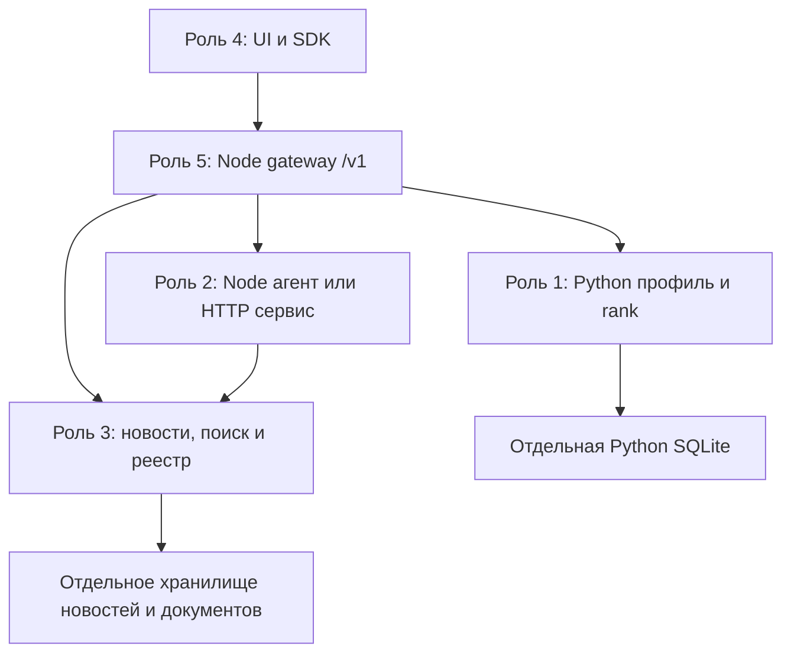

# ADR-001: Python domain + Node gateway/agent

Статус: реализовано локально, предлагается команде для review. Старые документы Node-прототипа описывают исходную реализацию; для нового интеграционного слоя приоритет у этого ADR и контрактов `/v1`.

## Границы

Python сохраняет бизнес-профиль и математическое ранжирование; Node сохраняет уже работающие UI, агент и API совместимости. Граница между средами — HTTP JSON. Нет subprocess на каждый запрос, общей SQLite-базы или зависимости от Node-типов внутри Python. Роль 3 может реализовать свой HTTP-сервис на FastAPI; контракт не требует переносить её код в Node.

| Сервис | Порт в dev | Владение состоянием | Реализация сейчас |
|---|---:|---|---|
| gateway | 8000 | Краткоживущие `/v1` анализы и история | `server/integration/gateway.ts` |
| ml | 8101 | Read-only ContextStore; отдельная предварительная сборка базы | `integration/app.py`, `integration/ml.py` |
| mocks | 8102 | Не хранит пользовательское состояние | `server/integration/mock-server.ts` |
| роль 2, замена | например 8202 | Собственная БД/кэш при необходимости | `provider-server.ts`, `SERVICE_KIND=agent`, либо новый HTTP-сервис |
| роль 3, замена | например 8203 | Новости, документы, индексы и реестр источников | `provider-server.ts`, `SERVICE_KIND=retrieval`, либо новый FastAPI-сервис |

В базовом Compose наружу опубликован только gateway на loopback. Имена `ml`, `mocks` используются внутри Docker-сети. `compose.development.yaml` отдельно открывает внутренние порты на loopback для разработчика. Для независимых процессов используются собственные `DB_PATH`, `CONTEXT_DB` и порты.

## Поток `/v1/analyze`

1. Проверить JSON и идентификаторы. Получить профиль Python и конкретное событие роли 3 на `as_of`.
2. Получить ранжирование этого события из Python и предварительные bank-фрагменты из роли 3.
3. Передать роли 2 `AgentRequest`: исходный профиль, событие, объяснения ранжирования, RAG, дату и аудиторию.
4. Агент формирует результат. HTTP-реализация может самостоятельно вызывать инструменты роли 3 и добавлять источники. Шлюз разрешает новые ID через `resolve_sources` и сверяет содержание с авторитетным реестром роли 3. Собственный company-source создаёт шлюз из Python-профиля.
5. Проверить JSON, company/news binding, известность источников и точность bank-цитат. Сохранить результат и краткую историю для уточнений.

Оркестрация шлюза фиксирует интеграционный поток; автономное планирование и выбор инструментов остаются внутри роли 2. Native-адаптер исходного Node-агента работает по предварительно выбранным RAG-фрагментам и без добавления связанных новостей; это явно указано в limitations. Сам модуль `server/agent.ts` не изменён.

## Реализации портов

`ContractClient` передаёт `X-Request-ID`, запрещает redirects, ограничивает ответ 8 МБ, проверяет схему и нормализует timeout/network/provider ошибки. Автоматических повторов POST нет. Таймаут ML/RAG — 5 секунд, HTTP-агента — 125 секунд; readiness агента проверяется отдельным коротким клиентом.

`RetrievalPort`: `search`, `rag`, `resolve`. Реализации: HTTP, mock, read-only адаптер существующего `Store/Retrieval`. Legacy-событие получает `event_type=other`, `fact_status=reported`: классификация и сущности не выдумываются. Событие без URL допускается только как помеченное demo с учебным URL. Недатированная аналитика банка исключается.

`AgentPort`: `analyze`, `answer`. Реализации: HTTP, mock, `LegacyAgent`. Последний создаёт `ProjectedStore` и `PreloadedRetrieval` через наследование существующих классов: компания/новость/rank/RAG берутся из входного контракта, а исходная проверка ответа и LLM-клиент сохраняются. Полный профиль доступен в `canonical_profile`, включая `null` и provenance. Старый кэш не включает Python snapshot; поэтому на `/v1` native-анализ всегда пересчитывается, а наружный ID создаётся отдельно.

Реальная Python-ветка подключается только как проверенный read-only overlay из точного SHA. Датасеты и исходные модули не копируются в отслеживаемое дерево интеграционного PR. Обновление SHA — отдельное изменение после тестов и review.

## Состояние и эксплуатационные границы

`/v1` хранит максимум 100 анализов в памяти gateway, срок — 1 час; история ограничена 10 парами question/answer. Перезапуск теряет эти сессии. Одновременно выполняются максимум два анализа/ответа; лишние запросы получают 429. В одной сессии вопросы сериализованы через 409. Это dev-инфраструктура; долговременное хранение и многорепличная очередь — отдельная последующая работа. Старый `/api` сохраняет собственные SQLite jobs/chats и прежнюю семантику.

Профиль `CONTEXT_MODE=fixture` создаётся в отдельной базе один раз; `CONTEXT_MODE=existing` читает явно заданную заранее собранную базу и не перестраивает её. Для смены fixture нужно явно пересоздать её dev-файл/volume. API не изменяет банковские CSV/PDF.

API рассчитан на локальную совместную разработку. `company_id` и старый `X-Company-ID` — выбор контекста, а не аутентификация. До внешнего размещения нужны согласованные auth/RBAC и политика доступа к данным. Compose уже привязан к loopback; этот PR не публикует сервис и не разворачивает production.

Логи шлюза включаются `INTEGRATION_LOG=1`: JSON с request ID, маршрутом, статусом и длительностью, без тела запроса и ключей. CI использует моки/demo и не требует LLM-секретов.
